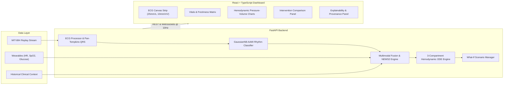

# Multimodal ECG Healthcare Digital Twin

A modular, research-oriented cardiovascular digital twin designed for hackathon demonstration. It fuses real-time ECG telemetry with wearable observations, classifies rhythm anomalies using reproducible ML baselines, and couples observations with a 3-compartment lumped-parameter hemodynamic simulation (Suga-Sagawa elastance + Windkessel) to perform what-if scenario experiments.

> [!CAUTION]
> **RESEARCH & PROTOTYPE DISCLAIMER**  
> This software is an educational proof-of-concept created for research and demonstration. It is **not** a certified medical device, does **not** connect to real patients or bedside telemetry, and must **never** be used for clinical diagnosis, patient monitoring, or treatment decisions.

---

## Architecture Overview



---

## Key Features

1. **Deterministic ECG Pipeline**:
   - 0.5–45 Hz Butterworth 3rd-order bandpass filter to suppress baseline wander and high-frequency noise.
   - Pan-Tompkins derivative and moving-average QRS detector.
   - Signal Quality Index (SQI) evaluator detecting flatlines and calculating signal-to-noise ratio (SNR).
   - Non-destructive MIT-BIH loader with patient-level train/validation/test splits preventing cross-subject data leakage.
2. **Reproducible Machine Learning Classifier**:
   - Baseline Gaussian Naive Bayes classifier mapped to AAMI EC57 rhythm categories (`N`, `S`, `V`, `F`, `Q`).
   - Explicit disclaimer of uncalibrated probabilities in schema metadata (`is_calibrated_probability: false`).
3. **Multimodal Data Fusion Engine**:
   - Freshness tracker flagging signals as `FRESH`, `STALE`, or `MISSING` based on configurable per-modality decay limits.
   - NEWS2 early warning risk score calculator.
   - Strict rejection of out-of-order timestamps, duplicate observations, and mismatched patient IDs.
4. **Cardiovascular Simulation Engine**:
   - 3-compartment lumped-parameter differential equation model: time-varying elastance left ventricle $E(t)$, systemic circulation, and systemic veins.
   - 4th-order Runge-Kutta (RK4) numerical integrator with adaptive forward Euler fallback.
   - Deterministic what-if scenario branching (Exercise, Vasodilation, Heart Failure) starting from identical baseline checkpoints.
5. **Doctor-Facing Digital Twin Dashboard**:
   - Dark clinical theme built with React 19, TypeScript, and Lucide icons.
   - Canvas-rendered ECG strip adhering to the international standard 25 mm/s paper speed and 10 mm/mV voltage grid.
   - Live WebSocket telemetry updates at 10 Hz with auto-reconnect and fallback polling.
   - Comprehensive provenance badges distinguishing Observed, Historical, Replayed, and Synthetic data.

---

## Directory Structure

```text
healthcare-digital-twin/
├── backend/
│   ├── .venv/                     # Python 3.14 virtual environment
│   ├── classifier.py              # GaussianNB AAMI rhythm classifier
│   ├── dataset_loader.py          # Non-destructive MIT-BIH dataset loader
│   ├── demo_simulation.py         # Standalone simulation history exporter
│   ├── ecg_processor.py           # Bandpass filter, Pan-Tompkins QRS, SQI
│   ├── fusion.py                  # Multimodal state manager, NEWS2, freshness
│   ├── main.py                    # FastAPI application & WebSocket server
│   ├── physiology.py              # 3-compartment cardiovascular ODE model
│   ├── replay_engine.py           # Asynchronous multi-speed ECG replayer
│   ├── scenarios.py               # What-if scenario comparative runner
│   ├── schemas.py                 # Pydantic v2 data models & validation
│   └── tests/
│       ├── test_ecg_pipeline.py       # ECG loading, windowing, and ML tests (11)
│       ├── test_fusion_and_replay.py  # Fusion, replay, and REST route tests (11)
│       ├── test_simulation_engine.py  # ODE hemodynamics and scenario tests (11)
│       └── test_e2e_workflow.py       # Full 14-step integration test (1)
├── frontend/
│   ├── src/
│   │   ├── components/            # UI panels (ECG, Vitals, Hemodynamics, etc.)
│   │   ├── services/api.ts        # REST and WebSocket client
│   │   ├── types.ts               # Strict TypeScript interfaces
│   │   └── App.tsx                # Main dashboard component
│   ├── package.json
│   └── vite.config.ts
├── docs/
│   ├── ARCHITECTURE.md            # System architecture and data flow
│   ├── DATA_AUDIT.md              # Biomedical data sources and MIT-BIH audit
│   ├── PHYSIOLOGY_MODEL.md        # Mathematical equations, units, parameters
│   ├── TEST_REPORT.md             # Complete QA audit and verification report
│   └── simulation_demo_output.json# Precomputed simulation baseline & scenarios
└── Readme.md                      # Project documentation and quickstart
```

---

## Quickstart Guide

### Prerequisites
- **Python**: 3.10+ (tested with Python 3.14)
- **Node.js**: 18+ (tested with Node.js 22)
- **PowerShell / Bash**

---

### 1. Backend Setup & Startup

From the project root:

```powershell
# Navigate to backend directory
cd backend

# Activate virtual environment
.\.venv\Scripts\Activate.ps1

# Install dependencies (if not already installed)
pip install -r requirements.txt

# Start FastAPI server on port 8000
python -m uvicorn backend.main:app --host 127.0.0.1 --port 8000 --reload
```

*Interactive Swagger UI documentation is available at:* `http://127.0.0.1:8000/docs`

---

### 2. Frontend Dashboard Setup & Startup

In a separate terminal:

```powershell
# Navigate to frontend directory
cd frontend

# Install npm dependencies (if not already installed)
npm install

# Start Vite development server
npm run dev
```

*Access the digital twin dashboard at:* `http://localhost:5173/`

---

### 3. Running All Tests

Execute the full automated test suite (34 unit & integration tests) from the project root:

```powershell
$env:PYTHONPATH="C:\Users\Suhani Thakur\healthcare-digital-twin"; .\backend\.venv\Scripts\pytest backend/tests
```

Run the complete 14-step End-to-End workflow harness with security edge cases:

```powershell
$env:PYTHONPATH="C:\Users\Suhani Thakur\healthcare-digital-twin"; .\backend\.venv\Scripts\python backend/tests/test_e2e_workflow.py
```

Run frontend type checks and production build:

```powershell
cd frontend
npm run build
```

---

## Tested Verification Summary

All 34 backend unit, integration, and E2E tests pass cleanly:
- `test_ecg_pipeline.py`: 11 passed
- `test_fusion_and_replay.py`: 11 passed
- `test_simulation_engine.py`: 11 passed
- `test_e2e_workflow.py`: 1 passed (14 assertion stages)
- Frontend build: 0 TypeScript errors, production assets bundled cleanly in `frontend/dist/`.

For full test results, parameter boundaries, and security edge case evaluations, refer to [docs/TEST_REPORT.md](file:///C:/Users/Suhani%20Thakur/healthcare-digital-twin/docs/TEST_REPORT.md).

