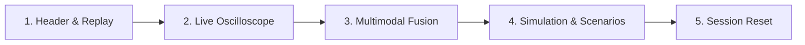

# Hackathon Demonstration Runbook

**System:** Multimodal ECG Healthcare Digital Twin  
**Audience:** Judges, Presenters, and Evaluators  
**Estimated Demo Duration:** 3–5 minutes

---

## 1. Quick Launch Checklist

Ensure two terminal windows are opened in the project root:

### Terminal 1: Backend Server
```powershell
cd backend
.\.venv\Scripts\Activate.ps1
python -m uvicorn backend.main:app --host 127.0.0.1 --port 8000 --reload
```
*Wait until output indicates:* `Application startup complete.`  
*Verify via browser:* `http://127.0.0.1:8000/health` (should return `"status": "healthy"`).

### Terminal 2: Doctor Dashboard Frontend
```powershell
cd frontend
npm run dev
```
*Open Google Chrome or Edge to:* `http://localhost:5173/`

---

## 2. Step-by-Step Live Demo Script



### Step 1: Session Selection & Header Controls
1. Point out the top header bar:
   - **Connection Status**: Green dot indicating active WebSocket connection (`CONNECTED @ 10Hz`).
   - **Patient Dropdown**: Default is Patient `100`. Notice that patient EHR history, demographics (58y / M), and active medications (Metoprolol, Aspirin) appear in the top-left card.
2. Click the **Start Replay** button (green Play icon).
   - Show how the simulation time counter immediately begins advancing.
   - Click the **2x** or **5x** speed multiplier button to demonstrate accelerated telemetry replay.

### Step 2: ECG Oscilloscope & Machine Learning Diagnosis
1. Direct attention to the **Real-Time ECG Strip**:
   - Note the standardized clinical ECG background grid (25 mm/s paper speed, 10 mm/mV voltage scaling).
   - Point out the **Signal Quality (SQI)** badge displaying `ACCEPTABLE` with Signal-to-Noise Ratio (SNR) in decibels.
2. Direct attention to the **Rhythm Classification Card**:
   - Observe the live AAMI class output (e.g. `Class N - Normal / Bundle branch block beat`).
   - Highlight the **Confidence Breakdown** bar chart.
   - Emphasize the **Clinical Transparency Badge**: *"Beat classification only — does not predict future acute coronary events."*

### Step 3: Multimodal Data Fusion & Stale Stream Detection
1. Scroll to the **Multimodal Freshness Matrix**:
   - Point out how each modality (`ECG Waveform`, `Heart Rate`, `Blood Glucose`) maintains an independent decay countdown.
   - Explain that modalities without current telemetry (e.g. `HRV Metrics`, `Invasive Blood Pressure`) are displayed with a grey **MISSING** status.
   - **Key takeaway for judges:** The system *never* fabricates missing sensor values.
2. Point out the **NEWS2 Clinical Risk Score**:
   - Show the dynamic early warning score and its transparent physiological breakdown.

### Step 4: Hemodynamic Simulation & What-If Scenarios
1. Scroll to the **Cardiovascular Simulation Panel**:
   - Explain the 3-compartment lumped-parameter ODE model (Suga-Sagawa elastance + Windkessel arterial/venous chambers).
   - Note the real-time biomarkers: Systolic Blood Pressure (~107 mmHg), Cardiac Output (~4.6 L/min), and Left Ventricular Volume.
2. In the **What-If Experiment Runner**:
   - Select the **Exercise (Tachycardia + Vasodilation)** preset from the dropdown.
   - Click **Run In-Silico Experiment**.
   - Review the delta comparison chart: Cardiac Output increases by **+3.31 L/min**, reflecting realistic physiological exercise tolerance.
   - Show the **Vasodilation (ACE Inhibitor / Nitro)** preset to demonstrate systemic arterial pressure dropping while maintaining stroke volume.

### Step 5: Session Isolation & Zero State Leakage
1. Click the **Stop** button in the header bar.
2. Switch the patient dropdown to **Patient 101**.
3. Point out that the previous patient's trends, alerts, and buffer histories have cleared completely, demonstrating zero cross-patient state leakage.

---

## 3. Troubleshooting & Backup Procedures

| Issue | Quick Fix |
| :--- | :--- |
| **WebSocket shows `DISCONNECTED`** | Verify Terminal 1 is still running without errors. Check that port 8000 is not blocked. |
| **ECG Waveform is flat or paused** | Ensure the **Play** button in the top header is active. If paused, click **Play** or **Resume**. |
| **Frontend fails to compile** | Run `npm install` in the `frontend/` directory, then `npm run dev`. |
| **Port 8000 is occupied** | Kill existing python processes with `Get-Process python \| Stop-Process` in PowerShell and restart Terminal 1. |

